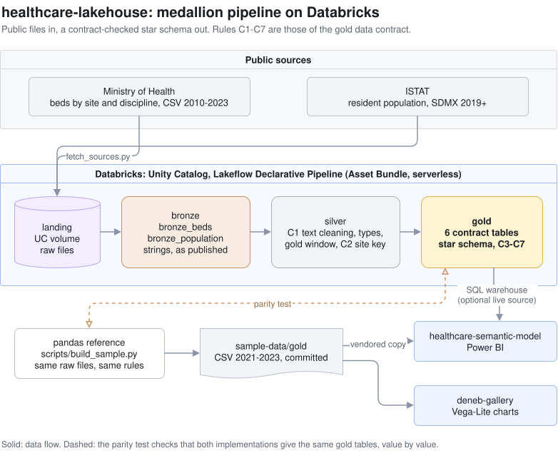

# healthcare-lakehouse

A PySpark medallion pipeline on Databricks. It turns the Italian Ministry of Health's hospital bed census
(by hospital site and discipline) and the ISTAT resident population into a star schema that a BI model can
use directly: *how many beds does each region have per 1,000 residents, by discipline, and how has that
changed?*

The raw files are public, messy and inconsistent across years. The gold layer fixes that once, under an
explicit data contract, so the consumers do not have to.

## Architecture



*The diagrams are `.drawio.svg` files: GitHub shows them as images, and draw.io (desktop, web or the VS Code extension) opens and edits them.*

- **Bronze** reads the files as strings with no inference. Nothing is changed.
- **Silver** applies rule C1 (text cleaning), casts types, keeps the gold window and builds the site key.
- **Gold** builds the six tables of the [data contract](docs/data-contract.md): `dim_year`, `dim_region`,
  `dim_discipline`, `dim_facility`, `fact_hospital_beds`, `fact_population`.

The transformations are plain functions from DataFrame to DataFrame in `src/healthcare_lakehouse/`. The
Lakeflow pipeline in `pipelines/` only names the datasets, reads the configuration and attaches the
data-quality expectations.

## Run it in 3 commands

Needs the [Databricks CLI](https://docs.databricks.com/dev-tools/cli/index.html) with a profile for a
workspace (set `<profile>` below to its name). Pass `-p <profile>` to **every** command: without it the
CLI falls back to the default profile, which may point to a different workspace. The workspace host is
read from the profile and is never stored in this repository.

```bash
databricks bundle deploy -t dev -p <profile>            # schema, volume and pipeline (serverless)
uv build --wheel && databricks fs cp -r data/raw dbfs:/Volumes/workspace/<schema>/landing -p <profile> \
  && databricks fs mkdir dbfs:/Volumes/workspace/<schema>/landing/_libs -p <profile> \
  && databricks fs cp dist/healthcare_lakehouse-0.1.0-py3-none-any.whl \
       dbfs:/Volumes/workspace/<schema>/landing/_libs/healthcare_lakehouse-0.1.0-py3-none-any.whl -p <profile>
databricks bundle run lakehouse -t dev -p <profile>      # bronze -> silver -> gold
```

The same steps, with the schema name read from the bundle, are in one script:

```bash
scripts/deploy_dev.sh <profile>                 # validate, deploy, upload, run
scripts/deploy_dev.sh <profile> --full-refresh  # after a schema change (e.g. a new contract column)
```

`<schema>` is the name the bundle gave the schema. In the `dev` target, development mode prefixes it with
your user name: `dev_<user>_healthcare_lakehouse`. `databricks bundle summary -t dev -p <profile>` shows it.
The pipeline settings refer to the schema resource, not to a fixed name, so they always point to the right
volume.

Before the first command, get the raw files with `uv run scripts/fetch_sources.py`, which writes them to the
git-ignored `data/raw/`. The second command uploads the raw files and the package wheel to the volume; the
pipeline reads its wheel from `landing/_libs/`. Nothing in this repository uploads data on its own.

The default gold window is 2019 to 2023. Change it with the `lakehouse.from_year` and `lakehouse.to_year`
settings in `resources/lakehouse.yml`.

## Tests

The package is tested with pytest on one of two Spark backends, chosen by the `SPARK_BACKEND` environment
variable (`conftest.py`).

```bash
# 1. Local Spark (CI). Needs Java 17 or later.
SPARK_BACKEND=local uv run --group local pytest

# 2. Databricks Connect on serverless compute. The profile comes from the environment, not from the code.
#    With an OAuth (U2M) profile the SDK asks the `databricks` CLI for a token, so the CLI must be on PATH.
#    In Git Bash, convert a Windows path first: export PATH="$(cygpath -u '<cli folder>'):$PATH"
export DATABRICKS_CONFIG_PROFILE=<profile>
export SPARK_BACKEND=databricks
uv run --group databricks pytest
```

The `local` and `databricks` dependency groups cannot be installed together (`[tool.uv] conflicts` in
`pyproject.toml`). Switching backend means `uv sync --group local` or `uv sync --group databricks`.

What the tests cover:

| File | What it checks |
|---|---|
| `tests/test_cleaning.py` | Rule C1, including the no-break space U+00A0 that Spark's `trim()` leaves in place |
| `tests/test_keys_and_scd.py` | C2 key, the silver year window, C3 whole-row SCD type 1, C4 ordinal key, C5, C6 |
| `tests/test_contract.py` | Gold column names, order and types against `docs/contract/gold_schema.yml`; no nulls in non-nullable columns; unique keys |
| `tests/test_parity.py` | All six gold tables for 2021-2023 against `sample-data/gold/*.csv`, cell by cell |
| `tests/test_reference.py` | The packaged region seed equals the contract copy |

The parity test needs `data/raw/`. Without it, the test is skipped and pytest prints the command that fetches
the files (`pytest -rs`). On the local backend the test reads the raw files with Spark's CSV reader. On
Databricks Connect the server cannot read local paths, so the same files are parsed with pandas.

### Continuous integration

`.github/workflows/lakehouse-ci.yml` runs `ruff check`, `ruff format --check` and the test suite on the local
backend. Before the tests, it fetches the three beds files for 2021-2023 and the population file with
`uv run scripts/fetch_sources.py --only beds_2021 beds_2022 beds_2023 population`. That step is non-blocking.
If the Ministry portal is unavailable, the parity tests are skipped and the skip reason is visible in the log.
Raw data is never committed, because it is git-ignored by design. The GitHub Ubuntu runners include Java,
so `setup-java` is not needed.

## The data contract

This repository **owns** the gold contract. Its human-readable form is
[`docs/data-contract.md`](docs/data-contract.md) and its machine-readable form is
[`docs/contract/gold_schema.yml`](docs/contract/gold_schema.yml). The two consumers,
`healthcare-semantic-model` and `deneb-gallery`, keep read-only copies of the schema and of the sample extract:

```bash
uv run scripts/vendor_contract.py --to ../healthcare-semantic-model
uv run scripts/vendor_contract.py --to ../deneb-gallery
uv run scripts/vendor_contract.py --to ../deneb-gallery --check   # exit 1 if a copy is stale
```

A change to a table, a column, a type, a key or a rule is a contract change. It bumps `contract_version` and
is re-vendored. The pandas reference, `scripts/build_sample.py`, implements the same rules. The parity test
checks that both implementations produce the same values.

## Design decisions

The decisions and their trade-offs are logged in [`docs/decisions.md`](docs/decisions.md). The main ones:

- **Two implementations, one answer.** The pandas script produces the committed sample and the PySpark code
  produces the lakehouse. The parity test keeps them in step (ADR-013).
- **Whole-row SCD type 1.** A site's attributes come from its latest row as a whole, never column by column,
  so a name from one year cannot be mixed with an address from another (C3).
- **Expectations cover row rules, not table rules.** Non-negative counts, the beds sum, valid region codes and
  population floors are expectations. Unique keys, foreign keys and "every year x region present" cannot be
  expressed per row, so they are enforced by construction and by the tests (ADR-015).
- **No host, token or profile name in the repository.** The bundle takes the workspace from the CLI profile.
- **The package travels as a wheel.** The pipeline installs it from the volume. The region seed is packaged
  with the code, and a test keeps it identical to the contract copy (ADR-014).

## Trade-offs

- The sample is duplicated in the three repositories (about 1.2 MB each). In exchange, each one builds without
  the others or a workspace.
- Spark's `trim()` and `\s` do not match U+00A0. Rule C1 is therefore written with explicit character sets.
  Python's pandas reference does the same, so the two implementations agree.
- `facility_key` is an ordinal of `facility_id` within the gold window. It is stable for a given window but not
  across windows, so consumers must join on the key, never hard-code it (C4).
- The local Spark backend needs Java. Contributors without Java can run only the Databricks backend.

## Data attribution

Contains data from the **Ministero della Salute** (Italian Ministry of Health), licensed under the
[Italian Open Data License v2.0](https://www.dati.gov.it/iodl/2.0/), and from **ISTAT** (Italian National
Institute of Statistics), licensed under [CC BY 4.0](https://creativecommons.org/licenses/by/4.0/). The data
has been cleaned, re-keyed and aggregated. Neither publisher endorses this project. Sources, formats and
caveats are in [`docs/data-sources.md`](docs/data-sources.md).

The code is under the MIT license (see [`LICENSE`](LICENSE)). The data in `sample-data/` keeps the licenses above.
