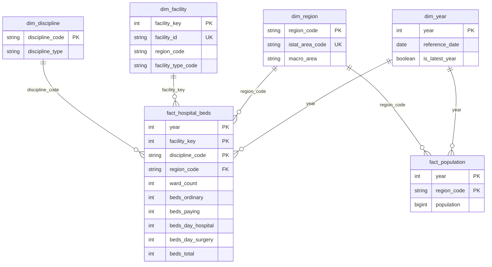

# Gold data contract

**Version:** 1.1.0 · **Machine-readable:** [`contract/gold_schema.yml`](contract/gold_schema.yml)

The gold layer is the interface between three repositories. This repository (`healthcare-lakehouse`)
**produces** it and **owns** this contract. `healthcare-semantic-model` and `deneb-gallery`
**consume** it through a vendored copy of [`gold_schema.yml`](contract/gold_schema.yml) and of the
extract in [`sample-data/gold/`](../sample-data/gold/), or through a Databricks SQL warehouse.

Any change to a table name, a column name, a type, a key or a rule below is a contract change. It
bumps `contract_version` here and is then re-vendored to both consumers:

```bash
uv run scripts/vendor_contract.py --to ../healthcare-semantic-model
uv run scripts/vendor_contract.py --to ../deneb-gallery
uv run scripts/vendor_contract.py --to ../deneb-gallery --check   # exit 1 if a copy is stale
```

## Model

A star schema with two fact tables at different grains that share the `year` and `region`
dimensions.



`dim_facility` also carries `region_code` as an attribute, but it has **no relationship** to
`dim_region`. The region reaches the beds fact directly through `fact_hospital_beds.region_code`,
so the model stays a pure star: no snowflake, and no ambiguous path between the two facts.

## Tables

| Table | Grain | Primary key | Rows (sample 2021–2023) |
|---|---|---|---|
| `fact_hospital_beds` | year × hospital site × discipline | `year, facility_key, discipline_code` | 35,053 |
| `fact_population` | year × region | `year, region_code` | 63 |
| `dim_facility` | hospital site | `facility_key` (business key `facility_id`) | 1,319 |
| `dim_discipline` | discipline | `discipline_code` | 69 |
| `dim_region` | region / autonomous province (20 ISTAT regions in `istat_region_name`) | `region_code` | 21 |
| `dim_year` | year | `year` | 3 |

Every column is described in [`gold_schema.yml`](contract/gold_schema.yml) with its type,
nullability, keys, allowed values and business definition. The summary below covers what a
consumer most needs to know.

### fact_hospital_beds

Active beds on **1 January** of `year`. The four regimes are additive and `beds_total` is their sum:

| Column | Meaning |
|---|---|
| `beds_ordinary` | ordinary (overnight) inpatient care |
| `beds_paying` | paying ordinary inpatient care, public sites only |
| `beds_day_hospital` | medical day care |
| `beds_day_surgery` | surgical day care |
| `beds_total` | `beds_ordinary + beds_paying + beds_day_hospital + beds_day_surgery` |
| `ward_count` | active wards. For private clinics it is a 0/1 flag, so do **not** sum it across facility types |

All counts are **additive across facilities, disciplines and regions**, and **semi-additive across
time**. Each year is a stock at 1 January, so never sum beds over several years.

### fact_population

ISTAT resident population on **1 January** of `year`, by region. It is semi-additive over time, like beds. Per-capita
metrics divide beds by population **of the same year and region**, so both are stocks on the same
date.

Always state which regimes a rate includes. In the 2023 sample, all beds give **3.61 per 1,000
residents**, and ordinary beds only (`beds_ordinary`) give **3.25**. International comparisons
usually refer to inpatient beds, so the second figure is the one to compare.

### dim_region

21 rows: 19 regions plus the autonomous provinces of Bolzano (041) and Trento (042), as the Ministry
codes them. This is a static reference table maintained in
[`contract/reference/regions.csv`](contract/reference/regions.csv). It maps the Ministry
`region_code` to the ISTAT `istat_area_code`, and adds the five-way `geographic_area` and the
three-way `macro_area` (Nord / Centro / Sud e Isole). Since 1.1.0 it also carries `istat_region_name`, the 20 ISTAT
regions: equal to `region_name`, except that Bolzano and Trento both read Trentino-Alto Adige. Use it for
views of the 20 regions, and sum beds and population before dividing (the per-capita measures do this by
construction).

### dim_facility

One row per hospital **site** (*stabilimento*). A public hospital organised on several sites
appears once per site, as the Ministry publishes it. `first_year` and `last_year` show when the
site appears in the gold window, so a site with `last_year` before the latest year has closed or
merged.

### dim_discipline

The 69 Ministry discipline codes. `discipline_type` follows the Ministry grouping:
Riabilitazione = 28, 56 and 75, Lungodegenza = 60, Acuti = everything else. Codes `02` (Day
Hospital) and `98` (Day Surgery) are published as disciplines. In 2021–2023 all their beds are in
the matching day regime (`beds_day_hospital` and `beds_day_surgery` respectively). They are kept as
they are.

## Rules (both builders implement them identically)

| Id | Rule |
|---|---|
| **C1** | Every text field, in this order: (1) no-break space U+00A0 → space, backtick → apostrophe (`` VALLE D`AOSTA `` → `VALLE D'AOSTA`); (2) runs of space, tab, CR or LF → one space; (3) trim; (4) empty → null. Original casing is kept. The character set is explicit on purpose: Python's `\s` matches U+00A0 but Spark's `\s` and `trim()` do not, and the 2021–2023 files contain it in one hospital name. |
| **C2** | `facility_id` = `structure_code` when `site_subcode` is null, otherwise `structure_code + "-" + site_subcode`. |
| **C3** | Dimension attributes are **SCD type 1**: each facility and discipline takes its attributes from the **latest year** it appears in within the gold window. |
| **C4** | `facility_key` = the position of `facility_id` in ascending order (1..N) over all facilities in the gold window. It is stable for a given window but **not** across different windows: always join on the key, never hard-code it. |
| **C5** | `health_authority_id` = `region_code + authority code`, because authority codes repeat across regions. |
| **C6** | `discipline_type` is the source value in sentence case (`ACUTI` → `Acuti`). |
| **C7** | Data-quality rules that fail the build: unique primary keys, no orphan foreign keys, counts ≥ 0, `beds_total` = the sum of the regimes, region codes present in the reference table, and population present for every year × region. |

## Gold window

The **gold window** is the set of years published in gold. It must lie within **2019–2023**, the
years covered by both sources. Beds go back to 2010 but population only to 2019, and beds stop at
2023.

| Consumer | Window |
|---|---|
| `sample-data/gold/` (committed and vendored) | **2021–2023** (keeps the extract at about 1.2 MB) |
| Lakehouse default | **2019–2023** (configurable). Facility keys differ from the sample's (rule C4) |

## CSV format (sample-data/gold)

UTF-8 without BOM, comma separator, a header row, LF line endings, ISO dates, booleans written as
`true` / `false`, null written as an empty field. **Codes are text**: `region_code` `010`,
`discipline_code` `08`, `municipality_code` `001272`. Consumers must read them as strings to keep
the leading zeros.

## Validation

```bash
uv run scripts/fetch_sources.py                 # raw files -> data/raw/
uv run scripts/build_sample.py                  # build + validate -> sample-data/gold/
uv run scripts/build_sample.py --check-only     # validate the committed CSVs only
```

The lakehouse has its own contract test, which compares gold DataFrame schemas with
`gold_schema.yml`.
